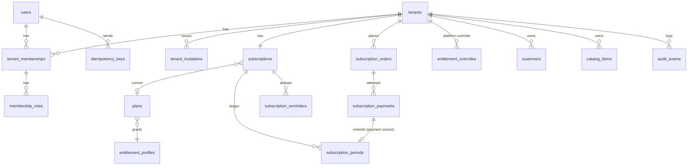

# Database design (E)

PostgreSQL 16. Migrations: `apps/api/database/migrations`. All domain ids are ULIDs (`char(26)`).

## ERD — implemented

## Tables (implemented)

| Table | Purpose | Key constraints |
|---|---|---|
| users | Accounts | unique lower-case email (CHECK), platform_role CHECK, encrypted 2FA secret column (MFA planned) |
| tenants | Companies | unique slug; suspension and closure timestamps |
| tenant_memberships | User ↔ company | UNIQUE(tenant_id,user_id), UNIQUE(tenant_id,id), status CHECK |
| membership_roles | Multi-role | PK(membership_id, role), role CHECK |
| tenant_invitations | Invites | token stored as SHA-256 only, expiry |
| audit_events | Append-only audit | **trigger rejects UPDATE/DELETE**; indexes (tenant_id, created_at), (subject) |
| idempotency_keys | Safe retries | UNIQUE(user_id, scope, key), prunable after 24 h |
| entitlement_profiles | Quotas/modules | separate from duration |
| plans | 4 packages | code CHECK (monthly/quarterly/half_yearly/yearly), duration CHECK (1,3,6,12), price ≥ 0 |
| subscriptions | One per tenant | UNIQUE(tenant_id); `expires_at` exclusive UTC; status CHECK; anchor_day CHECK |
| subscription_orders | Purchase intent + price snapshot | unique merchant_invoice_number, amount > 0 |
| subscription_payments | Gateway attempts | UNIQUE(gateway, gateway_payment_id), UNIQUE(gateway, verified_trx_id), **partial UNIQUE(order_id) WHERE verified_trx_id IS NOT NULL**, refund ≤ amount, composite FK to order |
| subscription_periods | Validity ledger | UNIQUE(payment_id); CHECK (source='payment') ⇔ payment_id; complimentary requires reason+granter; end > start |
| entitlement_overrides | Audited temporary write access | end > start |
| subscription_reminders | Reminder de-dup | UNIQUE(subscription, kind, expires_at_ref, channel) |
| customers | Customers | UNIQUE(tenant_id,id), indexes on (tenant,name/mobile/status), soft delete |
| catalog_items | Products/services | partial UNIQUE(tenant_id, lower(sku)) for live rows, price/discount/tax CHECKs (basis points) |

## Money precision

`bigint` minor units (poisha). Percentages in basis points (`int`, 10000 = 100 %).
Parsing/formatting: `App\Support\Money\Money` (API) and `src/lib/money.ts` (web), both tested.
Line-level rounding rules for invoices (planned): compute each line in minor units with
half-up rounding at line level, then sum — documented and tested in Phase 4.

## Sources of truth

* Subscription validity: `subscriptions.expires_at` (maintained only by `SubscriptionActivationService`),
  with `subscription_periods` as the explanatory ledger. `subscriptions.status` is informational.
* Payment success: `subscription_payments.verified_*` set only from gateway responses.
* (Planned) Receivables: invoice lines, schedules and allocations; balances derived, not stored.
  Any denormalised balance column must be recomputable and covered by a consistency check.

## Planned tables (Phases 4–7)

`invoice_sequences(tenant_id, prefix, next_number)` with row lock for gapless numbering ·
`invoices`, `invoice_items` (snapshot of catalog item at issue) · `collection_schedules` (installments) ·
`payment_promises` · `payments`, `payment_allocations` (composite FKs to invoice & schedule line),
`payment_reversals`, `credit_notes`, `customer_advances` · `recurring_invoice_rules` ·
`reminder_rules`, `reminder_templates`, `notification_jobs`, `notification_deliveries`, `sms_usage` ·
`stored_documents` (object key, checksum, tenant, owner) · `support_access_grants` (scoped, expiring, tenant-approved).

## Retention

* Business records are never deleted because a subscription expires (read-only only).
* Audit events: retain ≥ 7 years (financial context); never updated.
* Idempotency keys: 24 h. Subscription reminders: indefinite (small).
* Account closure (planned): owner request → 30-day export window → anonymise personal data
  where legally permitted, retain financial records per Bangladesh record-keeping law (to be confirmed by counsel).

## Tenant scoping strategy

See `docs/architecture/overview.md` § Authentication and tenant isolation.
