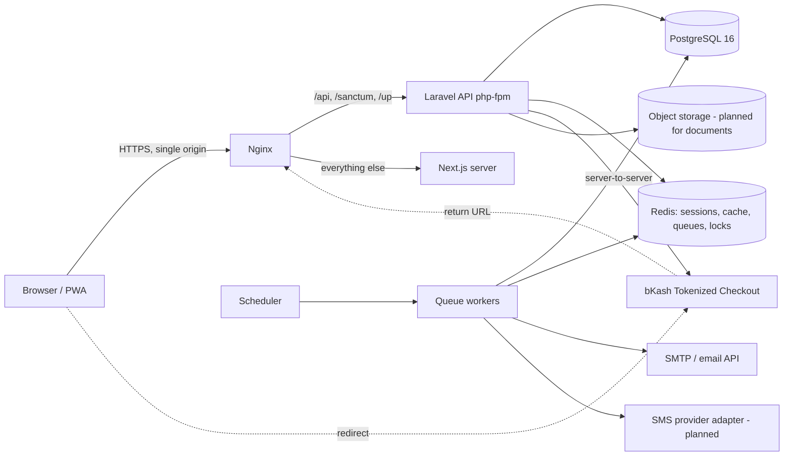

# Architecture

## Style

**Modular monolith.** One Laravel API, one Next.js frontend, PostgreSQL, Redis. No
microservices or Kubernetes in V1. Modules are folders with clear boundaries, not packages.

## System diagram (C)



### Why single origin
Sanctum's cookie-based SPA auth is simplest and safest when the browser sees one site:
cookies are first-party, `SameSite=Lax` works, no CORS preflights, no tokens in
`localStorage`. Development mirrors this with Next.js rewrites (`apps/web/next.config.ts`).

## Repository layout

```
apps/api      Laravel 13 API (PHP 8.3)
apps/web      Next.js 16 app (React 19, TS strict, Tailwind 4)
infra/docker  Dockerfiles, nginx config
infra/deployment  stack env template
docs/         requirements, architecture, security, subscriptions, testing, deployment
.github/workflows/ci.yml
```

## Backend modules and dependencies (D)

```
app/Support            cross-cutting: ApiException/ErrorCode, Money, BusinessClock, AuditLogger, Idempotency
app/Modules/Identity   users, auth controllers, registration
app/Modules/Tenancy    tenants, memberships, roles/permissions, TenantContext, BelongsToTenant, ResolveTenant
app/Modules/Subscriptions  plans, subscriptions, periods, orders, payments, gateway adapters,
                           entitlement service, read-only middleware/guards, admin
app/Modules/Customers  customers, BD phone normalisation
app/Modules/Catalog    products/services
(planned) Billing, Collections, Notifications, Reporting
```

Allowed dependencies: everything → Support; business modules → Tenancy, Subscriptions
(entitlement only); Subscriptions → Tenancy, Identity. Business modules never call each
other's internals except through services (e.g. Collections will use Billing's allocation service).

## API architecture (F)

* REST, JSON, versioned under `/api/v1`. Resources via Laravel API Resources.
* Tenant selected by `X-Tenant: <tenant ulid>` header; server verifies an **active membership**
  before any tenant query runs (middleware runs before route-model binding).
* Errors: `{"error": {"code": "STABLE_CODE", "message": "...", "details": {...}}}`; codes in
  `app/Support/Http/ErrorCode.php`. Validation errors under `details.fields`.
* Pagination: Laravel paginator `{data, links, meta}`; `per_page` capped at 100.
* Mutations that create money-relevant records take an `Idempotency-Key` header
  (`idempotent:<scope>` middleware: replay on same body, 422 on reuse with different body, 409 while in flight).
* Every tenant response carries `X-Subscription-Mode: full|read_only|suspended`.
* Route groups: public · account · tenant(renewal) · tenant(business, `business.write`) · admin.
  See the header comment in `apps/api/routes/api.php`.

Current endpoints: `php artisan route:list --path=api`.

## Authentication and tenant isolation (G)

| Layer | Control |
|---|---|
| Session | Sanctum SPA (session cookie, encrypted, HttpOnly, Secure in prod, SameSite=Lax) + CSRF (XSRF-TOKEN). Session regenerated on login; password reset revokes all sessions. |
| Login | Uniform hashing timing, generic error, 5 attempts / 15 min per email+IP, global `throttle:auth`. |
| Tenant resolution | `ResolveTenant`: ULID format check → active membership lookup → `TenantContext`. Unknown and foreign tenants both 404. Platform roles get nothing here without a membership. |
| Data access | `BelongsToTenant` global scope + creating hook. **Fails closed**: querying without context throws. Cross-tenant platform code must call `::acrossTenants()` explicitly (greppable). `tenant_id` immutable. |
| Database | `UNIQUE(tenant_id, id)` on parents and composite FKs `(tenant_id, x_id) → parent(tenant_id, id)` so rows can never reference another tenant's rows. |
| Authorization | `permission:<perm>` middleware from role→permission map; subscription gate `business.write`; model write guard. |
| Jobs | `RunInTenantContext` + `RequiresBusinessWriteEntitlement` middleware; jobs carry `tenantId`, context restored per job; scoped singletons reset per job. |
| Cache | Tenant keys must be prefixed `tenant:{id}:` (rule for upcoming caching; none cached yet). |
| Files | Local disk not publicly served (`serve=false`); planned: private object storage + signed, authorised downloads. |

## Architecture decision records

1. **ULID primary keys** for all domain tables — non-enumerable ids, sortable, no extra public-id column.
2. **Shared database, `tenant_id` column** (not schema/database per tenant) — simplest ops for
   hundreds–thousands of small tenants; isolation via scopes + composite FKs + tests.
   Revisit Postgres RLS as defence in depth before scale-up.
3. **Code-defined roles** (enum + permission map) instead of DB-editable roles — auditable, testable;
   custom roles can be added later without schema changes to callers.
4. **Read-only enforcement computed live** from `expires_at` (exclusive, UTC) — no dependency on cron.
5. **Gateway trust model:** browser return = hint; only server-to-server execute/query results,
   matched against the order, can extend a subscription.
6. **Integer minor units** for money; decimal strings in JSON inputs.
7. **Single origin** for SPA + API.
