# Subscription lifecycle, read-only mode and renewal

Implementation: `apps/api/app/Modules/Subscriptions`. Tests: `tests/Feature/Subscriptions`,
`tests/Unit/CalendarPeriodTest.php`, `tests/Concurrency`.

## Packages vs. entitlements

* **Plan (package)** = duration (1, 3, 6, 12 calendar months) + BDT price set by the super admin
  (`PATCH /api/v1/admin/plans/{id}`, audited). Seeded prices are placeholders.
* **Entitlement profile** = quotas/modules (users, SMS allowance, storage, invoice limit, modules).
  All four plans currently share the `standard` profile; trials use it too.
* Orders snapshot plan code, duration and price; later price changes never affect an order.

## State machine

```mermaid
stateDiagram-v2
    [*] --> pending_payment: registration (trial_days = 0)
    [*] --> active: registration with trial
    pending_payment --> active: verified payment / complimentary grant
    active --> active: renewal (extends from expires_at)
    active --> expired: expires_at passes (status synced by job; access already ended)
    expired --> active: verified payment (starts at activation time)
    active --> suspended: platform suspends tenant
    expired --> suspended: platform suspends tenant
    suspended --> active: unsuspend (if expires_at in future)
    suspended --> expired: unsuspend (if expires_at past)
    active --> cancelled: reserved for account closure workflow
```

The stored `status` is informational. **Effective access** is computed on every request by
`SubscriptionEntitlementService::stateFor()`:

1. Tenant suspended/closed or subscription `suspended` → **suspended** (read-only, no renewal).
2. `expires_at > now` and status ≠ cancelled → **full**.
3. An active `entitlement_override` → **full** (never overrides suspension).
4. Otherwise → **read_only** (`reason`: pending_payment | expired | cancelled).

No grace period for business writes.

## Calendar-month policy (one policy, Asia/Dhaka)

* Access is granted **through** a local date T (inclusive); `expires_at` = T+1 00:00 Asia/Dhaka, stored in UTC (exclusive).
* Fresh activation on local date D for N months → valid through **D + N months** (same day number).
* Month-end clamping: Jan 31 + 1 month → Feb 28/29. The **anchor day** (31) is remembered so
  the next renewal returns to Mar 31 (no drift).
* Early renewal (still valid) → extends from the current valid-through date.
* Renewal after expiry → starts at the verified activation time (fresh activation rules).
* Trials/complimentary days: N days including today (14-day trial from Jan 1 → through Jan 14);
  when still valid, days are added after the current valid-through date.
* Example: valid through 31 December ⇒ `expires_at` = 1 January 00:00 Asia/Dhaka = 31 December 18:00 UTC.

## Read-only enforcement (non-negotiable)

| Layer | Mechanism |
|---|---|
| HTTP | `business.write` middleware on the whole business route group: every non-GET/HEAD/OPTIONS request requires entitlement → `403 SUBSCRIPTION_EXPIRED` ("Renew your subscription to continue managing your business.") or `403 TENANT_SUSPENDED`, with `details.subscription`. Fail-closed for new routes. Runs **before** validation. |
| Models | `GuardsBusinessWrites` trait on business models (customers, catalog; all future invoice/payment models) blocks create/update/delete/restore without entitlement from any entry point. |
| Jobs | `RequiresBusinessWriteEntitlement` job middleware checks at execution time; skipped jobs are deleted, logged and audited — **no automatic catch-up** of missed reminders or recurring invoices after renewal. |
| Invitations | Accepting an invitation is a business write. |
| Allowed while read-only | Login/logout, all reads and exports, subscription pages, orders, checkout, payment results, password reset/email verification, platform renewal reminders. |
| UI | Banner with the mandated copy, Renew/View Packages, expiry date, Read-only indicator; `WriteGuard` disables actions; forms are locked. `X-Subscription-Mode` and `SUBSCRIPTION_EXPIRED` responses refresh the session so the UI flips mid-session without logout. |

## Renewal flow

1. Owner `POST /subscription/orders {plan_id}` (Idempotency-Key) → server price snapshot.
2. `POST /subscription/orders/{id}/checkout` (Idempotency-Key) → payment row (initiated) → gateway create → redirect URL.
3. Customer pays on the hosted checkout; gateway redirects to `/api/v1/subscription-payments/callback/{gateway}`.
4. Callback = hint. `success` → `execute()`; otherwise `query()`. Uncertain results → `unknown`.
5. Verification: payment id, merchant reference, currency, amount must match the order; trx id present and unused.
6. `SubscriptionActivationService::applyVerifiedPayment()` in a transaction with row locks on payment,
   order and subscription; `applied_at` marker + unique `subscription_periods.payment_id` make it idempotent.
7. Owners receive a receipt email; UI result page polls the payment and refreshes access.
8. `subscriptions:reconcile-payments` (every 5 min) re-queries open payments, finishes verified-but-unapplied
   ones, and expires checkouts abandoned for 24 h.

Duplicate successful payments for an already-paid order, mismatches and reused trx ids are flagged
`requires_review` for refund — never applied.

## Refunds and disputes (super admin)

* Refund goes through the gateway; local state changes only after the gateway confirms.
* Full refund of an applied payment revokes its period automatically **only when it is the latest
  period**; otherwise the payment is flagged for manual review (to avoid corrupting later periods).
* Partial refunds and disputes flag the payment; validity unchanged until an admin decides.

## Complimentary extensions and overrides

* `POST /admin/tenants/{id}/extensions {months|days, reason}` → `subscription_periods.source = complimentary`,
  granter and reason required by DB CHECK; never linked to a payment; no verified transaction id.
* `POST /admin/tenants/{id}/overrides {hours ≤ 168, reason}` → temporary write access, audited, revocable.
* There is **no** endpoint to mark a payment as verified manually.

## Renewal reminders

`subscriptions:send-reminders` daily 09:00 Asia/Dhaka: 7, 3, 1 days before the first read-only day,
on that day, and 3 days after. Unique ledger prevents duplicates; renewal changes `expires_at`
which re-arms reminders. Email only today; SMS channel arrives with the notifications module.
If the scheduler misses a day, that day's reminder is skipped (documented trade-off).
